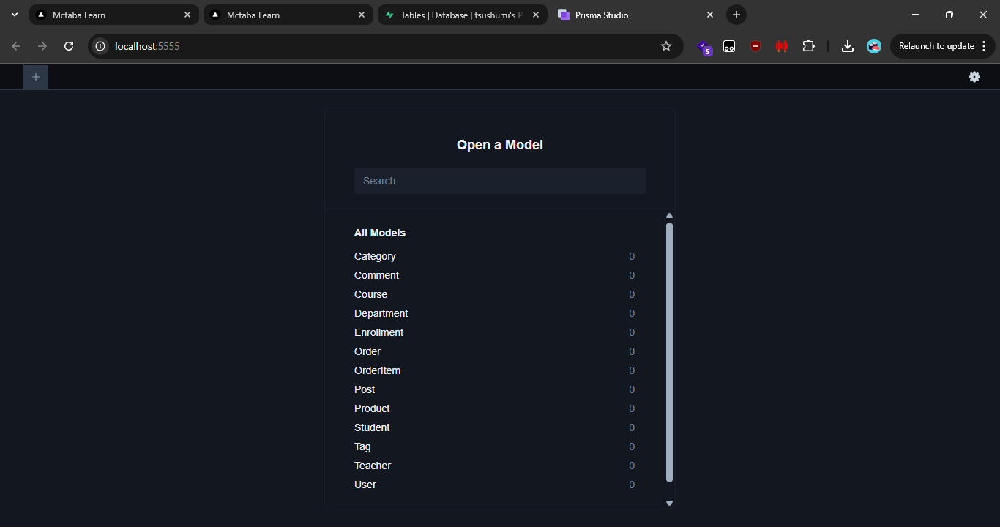

# week-6-day-2-assignment

## Setup on your machine
```bash
npm install
cp .env.example .env
# edit .env and paste your Supabase or Neon connection string
npx prisma migrate dev --name init-full-schema
```

## Screenshot for submission
```bash
npx prisma studio
```

